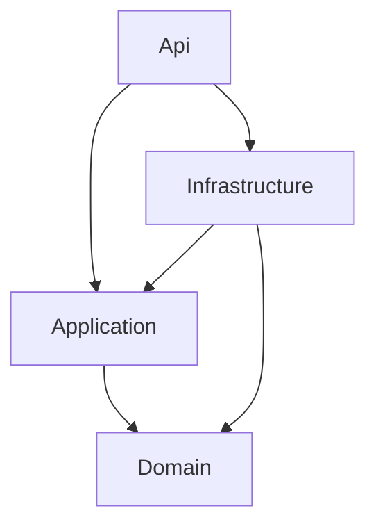
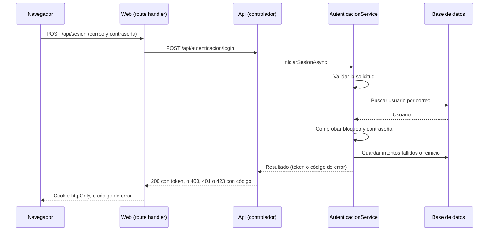

# Arquitectura

## Capas y dependencias

Cada flecha significa "depende de". Domain no depende de nadie; Api solo compone.

Las pruebas de `Toons.Tests/Arquitectura` hacen cumplir estas reglas.

## Flujo del login

