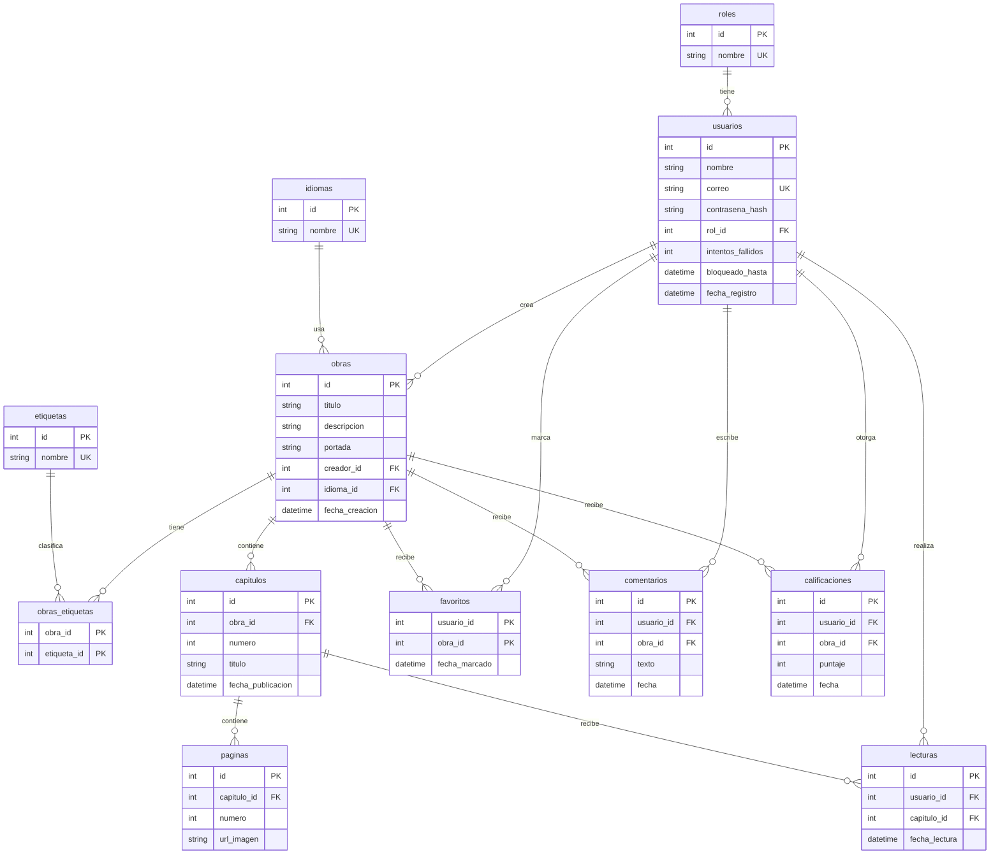

# Modelo de datos

Propuesta de Persona 3, revisada por Persona 2. Se puede modificar: ver el README para saber cómo.
Son 12 tablas en PostgreSQL con nombres en `snake_case` (paquete `EFCore.NamingConventions`).

## Restricciones

| Tabla | Restricción |
|---|---|
| roles, idiomas, etiquetas | `nombre` único |
| usuarios | `correo` único |
| capitulos | único (`obra_id`, `numero`) |
| paginas | único (`capitulo_id`, `numero`) |
| calificaciones | único (`usuario_id`, `obra_id`) y `puntaje` entre 1 y 5 (CHECK) |
| obras_etiquetas | clave primaria compuesta (`obra_id`, `etiqueta_id`) |
| favoritos | clave primaria compuesta (`usuario_id`, `obra_id`) |

## Comportamiento al borrar

- **Cascade** (se borra lo dependiente): filas de `obras_etiquetas` y `favoritos` (tablas puente), `paginas` de un capítulo y `capitulos` de una obra.
- **Restrict** (la base impide borrar si hay dependientes): todas las demás claves foráneas, por ejemplo un usuario con obras, un rol con usuarios, un idioma con obras, un capítulo con lecturas o una obra con comentarios y calificaciones.

## Datos de ejemplo

En Development, `SembradorDatos` llena una base vacía con datos ficticios y deterministas (semilla fija): 2 roles, 5 usuarios, 3 idiomas, 8 etiquetas, 10 obras (`portada-01.svg` a `portada-10.svg`), 40 capítulos, de 3 a 5 páginas por capítulo, 300 lecturas repartidas en los últimos 6 meses, favoritos, comentarios y calificaciones. Las fechas son relativas al momento de sembrar, así los reportes por mes siempre tienen datos recientes.
